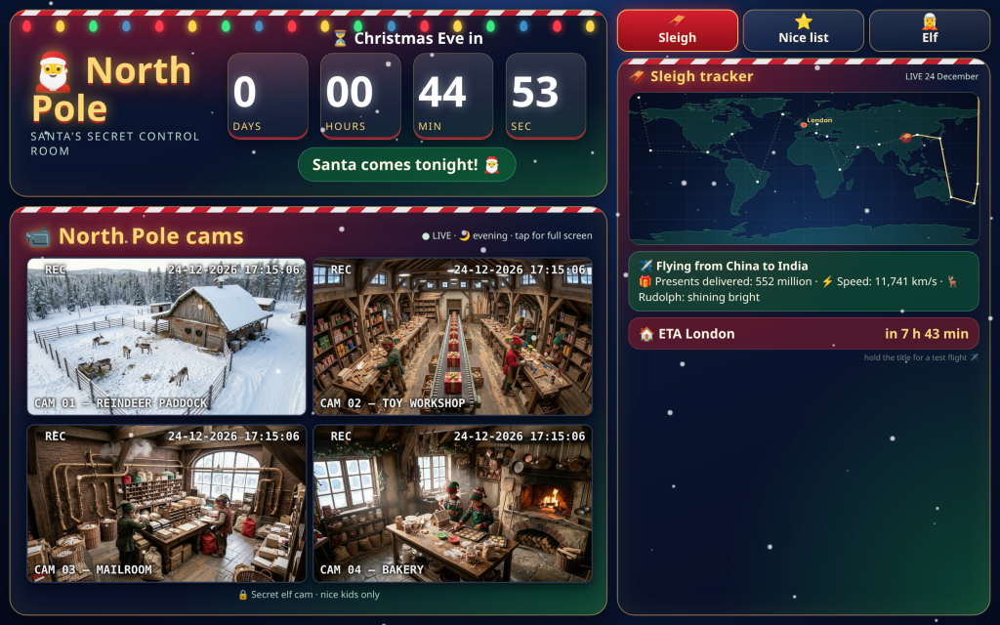
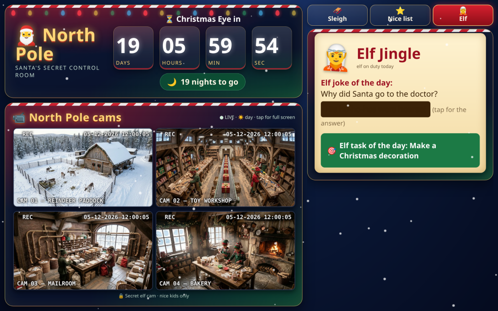

# 🎅 Nordpol Card

**🇬🇧 English · 🇩🇰 Dansk (Jul / Nisse) · 🇫🇷 Français (Noël / Lutin) · 🇩🇪 Deutsch (Weihnachten / Wichtel) · 🇪🇸 Español (Navidad / Elfo)**

A self-contained Christmas dashboard for Home Assistant – plug it into any dashboard:

* ⏳ **Countdown hero** with snow
* 📹 **North Pole CCTV wall** – looping clips that switch by time of day (optional, works without)
* 🛷 **Sleigh tracker** – simulated Santa flight on Dec 24 to *your* location (test flight: hold the title)
* ⭐ **Nice list** – kids + scores stored in a Local To-do list, parent mode, elf log
* 🧝 **Elf of the day** – 30 built-in elves (one per day, with a joke and a small task) or bring your own
* 🌍 English, Danish, French, German & Spanish built in; every string overridable
* 🎛️ **Visual UI editor** – configure the tablet board or any standalone card directly in Home Assistant’s graphical editor (no YAML required)


### Screenshots

| Sleigh tracker | Nice list | Elf of the day |
|---|---|---|
|  |  |  |

## Quick Start (3 steps)

### 1. Install the card
[](https://my.home-assistant.io/redirect/marketplace_repository/?owner=DKAnord&repository=nordpol-card&category=plugin)
[](https://my.home-assistant.io/redirect/hacs_repository/?owner=DKAnord&repository=nordpol-card&category=plugin)

<details>
<summary>Or install via Marketplace / HACS manually / without either</summary>

* **Home Assistant Marketplace (2026.11+):** *Settings → Marketplace* → search **Nordpol Card** (or add `https://github.com/DKAnord/nordpol-card` as a custom **Dashboard** repository) → install and reload the browser.
* **HACS (older Home Assistant):** *HACS* → search **Nordpol Card** (or *⋮ → Custom repositories* → add `https://github.com/DKAnord/nordpol-card`, type **Dashboard**) → install **Nordpol Card** and reload the browser.
* **Manual:** Copy `dist/nordpol-card.js` to `<config>/www/` and add a resource under *Settings → Dashboards → ⋮ → Resources* (`/local/nordpol-card.js`, JavaScript module).

</details>

### 2. Add the card (UI or YAML)
Create a new dashboard view with **View type: Panel** (so the tablet layout fills the screen), then either:
* **Visual Editor (easiest):** Click **+ Add Card** → pick **Nordpol: tablet board** (or any of the 5 individual Nordpol cards), and configure language, default tab, date, countdown target, sleigh ETA, to-do list entity picker, camera overlay/CCTV style, home button path, time zone, and snow toggle right in Home Assistant’s native `<ha-form>` UI editor (advanced YAML keys such as `cams.cams`, `strings`, and `sleigh.home` are preserved automatically)!
* **Or paste YAML:** Open **Raw configuration editor** and paste an example dashboard ([English](examples/dashboard.yaml), [Danish](examples/dashboard.da.yaml), [French](examples/dashboard.fr.yaml), [German](examples/dashboard.de.yaml), or [Spanish](examples/dashboard.es.yaml)):

```yaml
type: custom:nordpol-board-card   # best inside a Panel view
language: en                      # en | da | fr | de | es
nice:
  store: todo.nordpol_nice_list   # dedicated Local To-do list (or pick in the visual editor)
elf: {}
sleigh: { eta: "23:59" }
```

### 3. Enable the Nice list
Create a dedicated **Local To-do** list (e.g. `Nordpol nice list` → `todo.nordpol_nice_list`), then select it in the visual editor or set `nice.store` in YAML (if named `todo.nordpol_nice_list`, it is picked up automatically). All 12 North Pole cam videos and your HA location/time zone work out of the box:

[](https://my.home-assistant.io/redirect/config_flow_start/?domain=local_todo)

<details>
<summary>Advanced / Offline options (local videos, HA automations, custom location)</summary>

* **Offline / custom cam videos:** All 12 clips stream automatically, so you don't need to download anything. If you want local/offline copies in `<config>/www/nordpol/`, run this in the HA **Terminal & SSH** add-on (or download from [Release v2.1.0](https://github.com/DKAnord/nordpol-card/releases/tag/v2.1.0)):
  ```bash
  mkdir -p /config/www/nordpol && cd /config/www/nordpol && \
  curl -LO https://github.com/DKAnord/nordpol-card/releases/download/v2.1.0/nordpol-videos-cam1-2.zip && \
  curl -LO https://github.com/DKAnord/nordpol-card/releases/download/v2.1.0/nordpol-videos-cam3-4.zip && \
  unzip -o nordpol-videos-cam1-2.zip && unzip -o nordpol-videos-cam3-4.zip && rm -f nordpol-videos-cam*.zip
  ```
  See [docs/VIDEOS.md](docs/VIDEOS.md) for customising periods or generating your own clips.
* **Automations:** Add [`helpers/nordpol_package.yaml`](helpers/nordpol_package.yaml) if you want to award nice points from HA scripts/automations.
* **Sleigh home:** Defaults to your Home Assistant location and time zone. Override with `sleigh.home`.

</details>

## Individual cards
All 6 Nordpol cards can be used together in the tablet board or standalone in any view, with full graphical UI configuration in Home Assistant (`en`, `da`, `fr`, `de`, `es` labels & helper hints). Advanced YAML keys (`cams.cams`, `strings`, `sleigh.home`, `extra_stops`, custom `elves`) are preserved untouched by the visual editor.

| Card | Type | Visual editor options |
|---|---|---|
| Tablet board | `custom:nordpol-board-card` (`getConfigElement` `<ha-form>` + fallback) | `language`, `default_tab`, `date`, `hero.target`, `sleigh.eta`, `nice.store` (`todo` picker), `cams.overlay`, `cams.cctv_style`, `home_button.path`, `time_zone`, `hero.snow` |
| Countdown hero | `custom:nordpol-hero-card` (`getConfigForm`) | `language`, `date`, `title`, `subtitle`, `target`, `until`, `time_zone`, `snow` |
| North Pole cams | `custom:nordpol-cam-card` (`getConfigForm`) | `language`, `title`, `overlay`, `cctv_style`, `date_format`, `time_zone`, `footer`, `glitch` |
| Sleigh tracker | `custom:nordpol-sleigh-card` (`getConfigForm`) | `language`, `title`, `eta`, `date`, `time_zone` |
| Nice list | `custom:nordpol-nice-card` (`getConfigForm`) | `language`, `title`, `store` (`todo` picker), `log_entity` (`input_text` picker), `default_start`, `log_lines` |
| Elf of the day | `custom:nordpol-elf-card` (`getConfigForm`) | `language`, `title`, `date`, `time_zone`, `entity` (entity picker) |

## Configuration reference (board card)
| Key | Default | Description |
|---|---|---|
| `language` | browser/HA | `en`, `da`, `fr`, `de`, or `es` |
| `strings` | – | override any text |
| `default_tab` / `return_after_min` | `sleigh` / `3` | tab shown, and auto-return time |
| `date` | `12-24` | celebration day as `MM-DD` – e.g. `12-25`, or `01-07` for Orthodox Christmas. Moves the countdown, sleigh flight and elf calendar. Also set `sleigh.eta`, and `hero.until` for the countdown label |
| `time_zone` | HA `time_zone` | IANA time zone (e.g. `Europe/Paris`) used for the countdown, cam clock, and elf calendar (falls back to HA server time zone, then browser local time) |
| `hero.title/subtitle/target/snow` | – | header; `hero.target` (`MM-DD HH:MM` or `HH:MM`) sets the exact countdown target (defaults to `12-24 18:00` for `en`/`da`/`de`, `12-25 00:00` for `fr`/`es`, or `00:00` when `date` is changed) |
| `cams.cams[]` | `[]` | `label`, optional `file`, optional fallback `src` |
| `cams.file_dir` / `cams.periods` | `/local/nordpol` / morning, day, evening | see VIDEOS.md |
| `cams.overlay` | `minimal` | `minimal` = REC dot, live date/clock and camera label on top of your clip, nothing else · `true` / `cctv` = also scanlines, vignette and muted colours · `false` / `off` = clip only |
| `cams.cctv_style` | `color` | only with `overlay: true` / `cctv`: `color` (muted) or `mono` (black & white) |
| `cams.date_format` | `DD-MM-YYYY HH:mm:ss` | tokens `YYYY MM DD HH mm ss` – e.g. `MM/DD/YYYY HH:mm:ss` for US |
| `sleigh.eta` | `23:59` | local time Santa reaches *you* on Dec 24; all other stops shift with it |
| `sleigh.home` | HA location + time zone | `{name, lat, lon, tz}` override |
| `sleigh.extra_stops` / `sleigh.skip_stops` | – | add `{name, lat, lon, utc_offset, local}` or hide named stops |
| `nice.store` / `nice.log_entity` / `nice.default_start` / `nice.log_lines` | `todo.nordpol_nice_list` (if present) / – / `75` / `4` | dedicated to-do list backing the nice list (set explicitly in YAML or the visual editor, or name the list `Nordpol nice list`; the Elf Log is stored inside the same list automatically if `log_entity` is omitted; `log_lines` sets how many log entries show; the Emoji field also accepts image URLs like `/local/kids/emma.jpg`) |
| `elf.elves` | 30 built-in | your own list: `[{name, joke, task}, …]`. Day 1…30 of the advent calendar picks entry 1…30 (Dec 1 = entry 1). Jokes are written as `question? answer` |
| `elf.entity` | built-in | optional sensor whose state (`name\|joke\|task`) overrides the elf of the day |
| `home_button` | none | `{label, icon, path}` extra tab that navigates to another dashboard |

## Credits & licence
MIT – see [LICENSE](LICENSE). World outline: [Natural Earth](https://www.naturalearthdata.com/) (public domain). Videos (optional pack): AI-generated with Google Flow (Veo), shared for personal Home Assistant dashboard use.

Maintainer: `DKAnord` (`12734694+DKAnord@users.noreply.github.com`)
