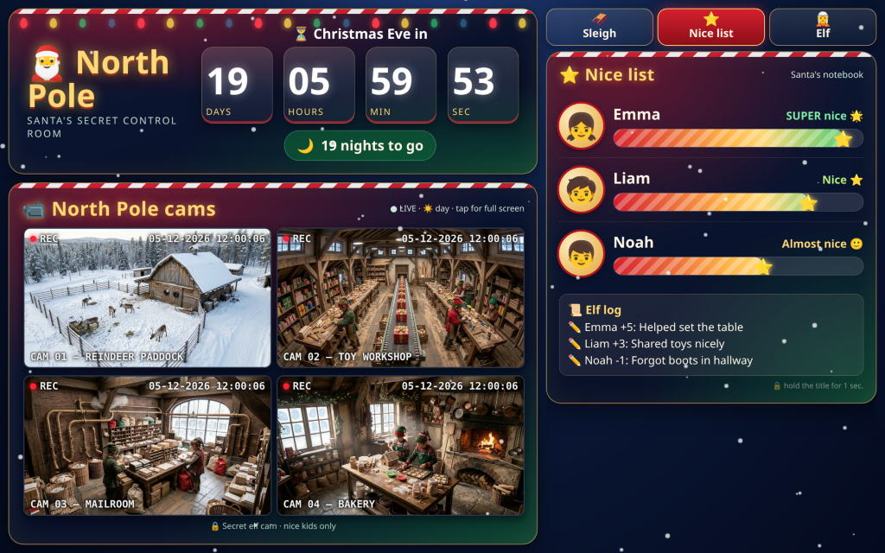

# 🎅 Nordpol Card

A self-contained Christmas dashboard for Home Assistant – plug it into any dashboard:

* ⏳ **Countdown hero** with snow
* 📹 **North Pole CCTV wall** – looping clips that switch by time of day (optional, works without)
* 🛷 **Sleigh tracker** – simulated Santa flight on Dec 24 to *your* location (test flight: hold the title)
* ⭐ **Nice list** – kids + scores stored in a Local To-do list, parent mode, elf log
* 🧝 **Elf of the day** – 30 built-in elves (one per day, with a joke and a small task) or bring your own
* 🌍 English & Danish built in; every string overridable


<details>
<summary>Screenshots (Sleigh tracker · Nice list · Elf of the day)</summary>

| Sleigh tracker | Nice list | Elf of the day |
|---|---|---|
|  |  |  |

</details>

## Install

### HACS (custom repository)
1. HACS → ⋮ → **Custom repositories** → add `https://github.com/DKAnord/nordpol-card`, type **Dashboard**.
2. Install **Nordpol Card**, reload the browser.

### Manual
Copy `dist/nordpol-card.js` to `<config>/www/` and add a resource: Settings → Dashboards → ⋮ → Resources →
`/local/nordpol-card.js` (JavaScript module).

## Minimal setup
```yaml
type: custom:nordpol-board-card   # use a *panel* view for the full tablet layout
language: en
elf: {}
sleigh: { eta: "23:59" }
```
Full example: [`examples/dashboard.yaml`](examples/dashboard.yaml) · Danish: [`examples/dashboard.da.yaml`](examples/dashboard.da.yaml)

## Optional pieces
| Feature | What you need |
|---|---|
| Nice list | Add the **Local To-do** integration (e.g. `todo.nordpol_nice_list`) and set `nice.store`. Optionally add [`helpers/nordpol_package.yaml`](helpers/nordpol_package.yaml) for the elf log and automation scripts. |
| Cam videos | Put clips in `<config>/www/nordpol/` – see [docs/VIDEOS.md](docs/VIDEOS.md). |
| Sleigh home | Defaults to your HA location/time zone. Override with `sleigh.home`. |

## Individual cards
`nordpol-board-card` (everything, tabbed) · `nordpol-hero-card` · `nordpol-cam-card` · `nordpol-sleigh-card` ·
`nordpol-nice-card` · `nordpol-elf-card` – all can be used standalone in any view.

## Configuration reference (board card)
| Key | Default | Description |
|---|---|---|
| `language` | browser/HA | `en` or `da` |
| `strings` | – | override any text |
| `default_tab` / `return_after_min` | `sleigh` / `3` | tab shown, and auto-return time |
| `date` | `12-24` | celebration day as `MM-DD` – e.g. `12-25`, or `01-07` for Orthodox Christmas. Moves the countdown, sleigh flight and elf calendar. Also set `sleigh.eta`, and `hero.until` for the countdown label |
| `hero.title/subtitle/snow` | – | header |
| `cams.cams[]` | `[]` | `label`, optional `file`, optional fallback `src` |
| `cams.file_dir` / `cams.periods` | `/local/nordpol` / morning, day, evening | see VIDEOS.md |
| `cams.overlay` | `minimal` | `minimal` = REC dot, live date/clock and camera label on top of your clip, nothing else · `true` = also scanlines, vignette and muted colours · `false` = clip only |
| `cams.cctv_style` | `color` | only with `overlay: true`: `color` (muted) or `mono` (black & white) |
| `cams.date_format` | `DD-MM-YYYY HH:mm:ss` | tokens `YYYY MM DD HH mm ss` – e.g. `MM/DD/YYYY HH:mm:ss` for US |
| `sleigh.eta` | `23:59` | local time Santa reaches *you* on Dec 24; all other stops shift with it |
| `sleigh.home` | HA location + time zone | `{name, lat, lon, tz}` override |
| `sleigh.extra_stops` / `sleigh.skip_stops` | – | add `{name, lat, lon, utc_offset, local}` or hide named stops |
| `nice.store` / `nice.log_entity` / `nice.default_start` | – / – / `75` | to-do list backing the nice list (the Elf Log is stored inside the same list automatically if `log_entity` is omitted; the Emoji field also accepts image URLs like `/local/kids/emma.jpg`) |
| `elf.elves` | 30 built-in | your own list: `[{name, joke, task}, …]`. Day 1…30 of the advent calendar picks entry 1…30 (Dec 1 = entry 1). Jokes are written as `question? answer` |
| `elf.entity` | built-in | optional sensor whose state (`name\|joke\|task`) overrides the elf of the day |
| `home_button` | none | `{label, icon, path}` extra tab that navigates to another dashboard |

## Credits & licence
MIT – see [LICENSE](LICENSE). World outline: [Natural Earth](https://www.naturalearthdata.com/) (public domain). Videos (optional pack): AI-generated with Google Flow (Veo), shared for personal Home Assistant dashboard use.

Maintainer: `DKAnord` (`12734694+DKAnord@users.noreply.github.com`)
